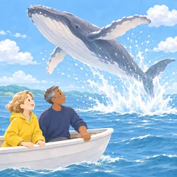

**English** · [中文](README.zh.md) · [한국어](README.ko.md) · [日本語](README.ja.md) · [Tiếng Việt](README.vi.md)

<p>
<a href="https://scenewords.dictationtrainer.com/#dive_verb_01"></a>
<a href="https://scenewords.dictationtrainer.com/#bakery_noun_01"></a>
<a href="https://scenewords.dictationtrainer.com/#colorful_adj_01"></a>
<a href="https://scenewords.dictationtrainer.com/#warehouse_noun_01"></a>
<a href="https://scenewords.dictationtrainer.com/#whale_noun_01"></a>
<a href="https://scenewords.dictationtrainer.com/#chef_noun_01"></a>
<a href="https://scenewords.dictationtrainer.com/#luggage_noun_01"></a>
<a href="https://scenewords.dictationtrainer.com/#elephant_noun_01"></a>
<a href="https://scenewords.dictationtrainer.com/#supervisor_noun_01"></a>
<a href="https://scenewords.dictationtrainer.com/#pottery_noun_01"></a>
<a href="https://scenewords.dictationtrainer.com/#ice_cream_noun_01"></a>
<a href="https://scenewords.dictationtrainer.com/#violin_noun_01"></a>
</p>

# Scenewords

600 English words for work and everyday life. Each one has its own illustration and one sentence that describes the picture.

by Dictation Trainer · built on the TOEIC® Service List 1.2

**600** words · **600** illustrations · **600** example sentences · US audio for every word · definitions in 中文 · 한국어 · 日本語 · Tiếng Việt · CC BY-SA 4.0

**[Practice dictation on dictationtrainer.com →](https://dictationtrainer.com/series/picture-words-600?utm_source=scenewords&utm_medium=readme&utm_campaign=open-source)** · [Browse the pictures](https://scenewords.dictationtrainer.com/) · [Download](https://github.com/goodspeed2011/scenewords/archive/refs/heads/main.zip) · [Hugging Face](https://huggingface.co/datasets/goodspeed2011/scenewords) · [Anki decks](https://github.com/goodspeed2011/scenewords/releases/latest)

## A sample

| Picture | Word | Sentence | Practice |
| --- | --- | --- | --- |
|  | **deadline** n.<br>/ˈdɛdˌlaɪn/<br>截止日期；最后期限 · 마감 기한, 마감일 · 締め切り · hạn chót | The designer is working late to meet the **deadline**. | [Listen and dictate](https://dictationtrainer.com/sets/picture-office-1?utm_source=scenewords&utm_medium=readme&utm_campaign=open-source#sentence-6) |
|  | **luggage** n.<br>/ˈlʌɡədʒ/<br>行李 · (여행) 짐, 수하물 · 荷物、手荷物 · hành lý | A woman is pulling her **luggage** past a row of empty seats. | [Listen and dictate](https://dictationtrainer.com/sets/picture-travel-1?utm_source=scenewords&utm_medium=readme&utm_campaign=open-source#sentence-8) |
|  | **sunscreen** n.<br>/ˈsʌnˌskrin/<br>防晒霜 · 자외선 차단제, 선크림 · 日焼け止め · kem chống nắng | She is putting on **sunscreen**. | [Listen and dictate](https://dictationtrainer.com/sets/picture-leisure-4?utm_source=scenewords&utm_medium=readme&utm_campaign=open-source#sentence-14) |

All 600 are in [the picture browser](https://scenewords.dictationtrainer.com/).

## What is here, and what is on the site

<table>
<tr>
<td valign="top" width="50%">

**In this repository**

- Illustrations (768 px WebP and 256 px thumbnails)
- Words, part of speech, US IPA, English definitions, topics
- Definitions in Chinese, Korean, Japanese and Vietnamese
- The example sentence for each picture
- US pronunciation of every word
- The scene description each picture was drawn from

</td>
<td valign="top" width="50%">

**On [dictationtrainer.com](https://dictationtrainer.com/series/picture-words-600?utm_source=scenewords&utm_medium=readme&utm_campaign=open-source)**

- Audio of every example sentence
- Sentence translations
- 40 lessons with word-by-word checking
- A mistakes notebook and review
- The 600-word picture wall

</td>
</tr>
</table>

## Files

```
data/words.json          600 entries, every field
data/words.csv           the same, one row per word
data/topics.json         11 topics, named in five languages
media/img/               768 px WebP, one per word
media/thumb/             256 px WebP
media/audio/word-us/     MP3, one per word
docs/                    dataset.md · pipeline.md · quality.md
index.html, viewer/      the picture browser
scripts/validate.mjs     checks fields and media
PUBLIC_MANIFEST.json     every file with its size and SHA-256
```

Every field is described in [docs/dataset.md](docs/dataset.md). To check a download, run `node scripts/validate.mjs --hashes`.

## Open it on your computer, or host your own copy

- [Download the repository](https://github.com/goodspeed2011/scenewords/archive/refs/heads/main.zip), unzip it and double-click `index.html`. It works offline.
- Or serve the folder with any web server. For example, run this inside the folder:

  ```
  python3 -m http.server 8765
  ```

  and open http://127.0.0.1:8765/ in your browser.
- It is a static site with no build step. To put your own copy online, upload the whole folder to any static host, such as GitHub Pages, Cloudflare Pages or Netlify. Please keep the credits at the bottom of the page: CC BY-SA 4.0 asks for them.

## How it was made

- **Words**: 600 of the 1,250 words in the TOEIC® Service List 1.2, chosen because they can be drawn.
- **Sentences and definitions**: written with AI help and checked by script. The target word is the only word from the list in each sentence.
- **Illustrations**: made with an AI image model, one picture per word, from a written scene. An AI reviewer checked each one against a written list: no text, no logos, the right action, the right number of hands. 63 were drawn again. The maintainer also confirmed the review of the first 235.
- **Pronunciation**: US IPA from the CMU Pronouncing Dictionary. For 73 words the dictionary had no fitting form, and their IPA was written by AI. The audio is a synthetic voice, checked with speech recognition.
- **Translations**: written with AI and not yet reviewed by native speakers. Corrections are welcome: [open an issue](https://github.com/goodspeed2011/scenewords/issues).

The details, and what is still imperfect, are in [docs/pipeline.md](docs/pipeline.md) and [docs/quality.md](docs/quality.md).

## License

| | |
| --- | --- |
| **Content** | Words, sentences, definitions, scene descriptions, illustrations and audio: [CC BY-SA 4.0](CONTENT_LICENSE.md) |
| **Code** | [MIT](LICENSE) |
| **Word list** | TOEIC® Service List 1.2, Charles Browne and Brent Culligan, CC BY-SA 4.0 |
| **Illustrations and audio** | AI-generated. Licensed only to the extent that we hold rights in them. |
| **Pronunciations** | IPA mostly derived from the CMU Pronouncing Dictionary (BSD license) |

To credit this work, write: Scenewords by Dictation Trainer, CC BY-SA 4.0, https://github.com/goodspeed2011/scenewords

---

<sub>TOEIC is a registered trademark of ETS. This project is not endorsed or approved by ETS.</sub>
